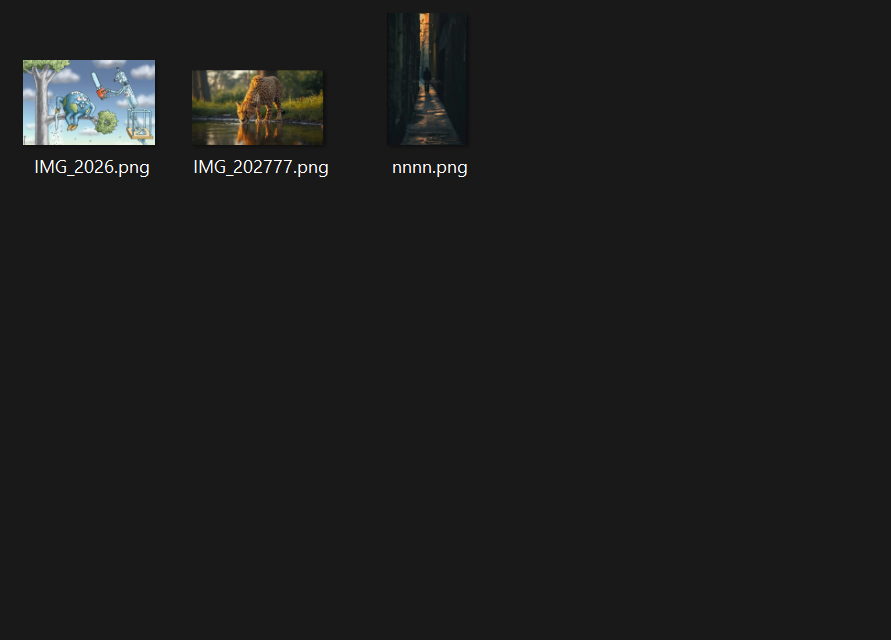
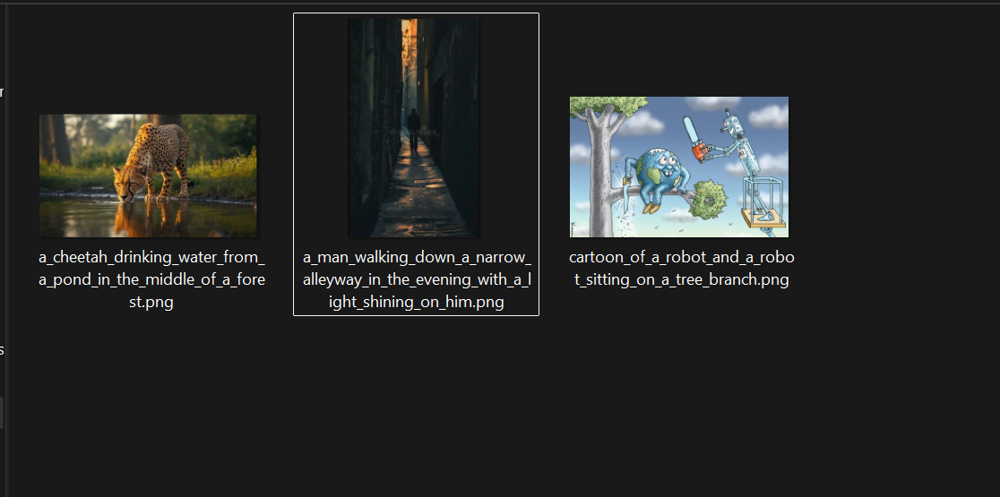
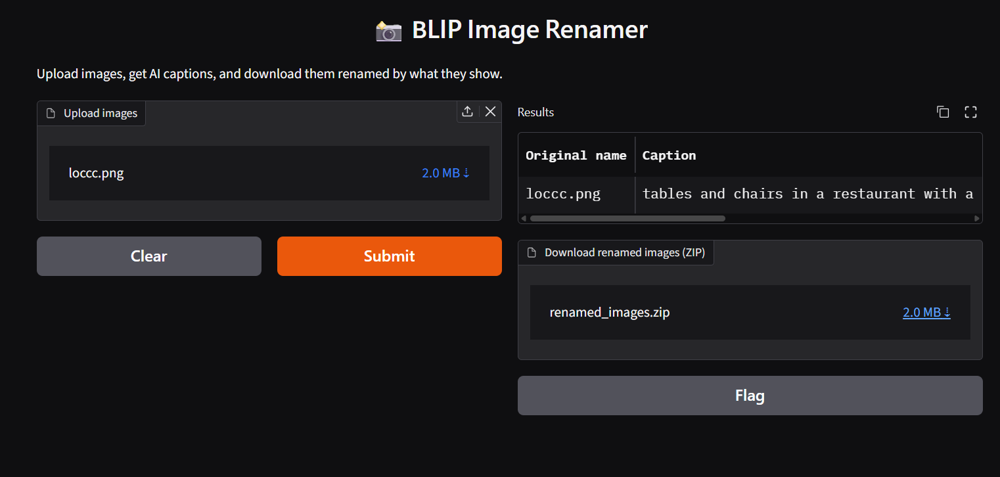

# 📸 BLIP Image Renamer

An AI tool that automatically captions images and renames them based on what they show, using Salesforce's BLIP model from Hugging Face.

**Before:** `IMG_202777.png`
**After:** `a_cheetah_drinking_water_from_a_pond_in_the_middle_of_a_forest.png`




## 🖥️ Web App


## ✨ Features
- 🌐 Web interface (Gradio): upload images, see captions, download renamed copies as a ZIP
- Captions every image in a folder (jpg, jpeg, png)
- Renames each file from its caption
- Removes characters Windows doesn't allow in filenames
- Avoids overwriting files that get the same caption (adds `_1`, `_2`)
- Logs old and new names to `captions.txt`

## 🛠️ Tech Stack
Python · Hugging Face Transformers · BLIP (`blip-image-captioning-large`) · PyTorch · Pillow · Gradio

## 🚀 How to Run
```bash
python -m venv my_env
my_env\Scripts\activate
pip install -r requirements.txt
```

**Web app (recommended):**
```bash
python app.py
```
Then open http://127.0.0.1:7860 in your browser.

**Command line (renames files in a folder):**
Set `image_dir` in `caption_folder.py` to your images folder, then run:
```bash
python caption_folder.py
```
> ⚠️ The command-line script renames files, so test it on copies of your images first.

## 💡 What I Learned
- How image-to-text models work: convert the image, process it, generate a caption, and decode it.
- The base model gives short captions, while the large model gives more detail.
- BLIP describes photos well but can't read text in posters. OCR (reading text from images) is the next upgrade.
- Post-processing: cleaning model output (e.g., removing BLIP's "araffe" quirk) before using it.
- Building a web interface with Gradio (inputs and outputs map to function parameters and return values).

## 🎓 Context
Built while taking IBM's *Building Generative AI-Powered Applications with Python* course.